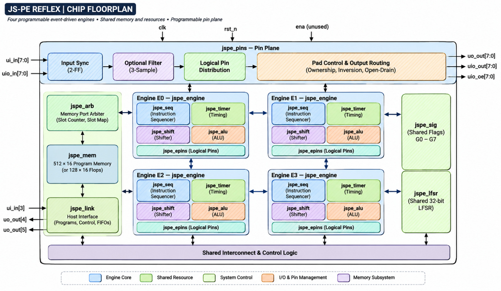
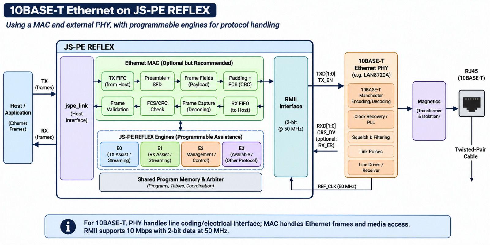

   

# JS-PE: a programmable protocol emulator ASIC

- My entry to the [Jane Street protocol emulator ASIC competition](https://blog.janestreet.com/protocol-emulator-asic-competition/): a Tiny Tapeout chip on IHP 130 nm (SG13 CMOS5L), 8x4 tiles, that runs serial protocols as programs.
- Four small engines each hold one instruction `guard : operation` and fire it in the clock its event arrives, so a pin edge becomes a pin change in 3–4 clocks with no fetch in between. Nothing protocol-specific is in hardware.
- UART, SPI and I2C were the brief. WS2812, Manchester and CAN 2.0A were brought up later on the frozen RTL with no RTL change; CAN was written after the freeze. All results so far are from simulation; there is no silicon or board run yet.

----

## 2. Results at a glance

| Item | Result | Source |
|---|---|---|
| Process, size | IHP SG13 CMOS5L via the Tiny Tapeout IHP template, 8x4 tiles, top `tt_um_notcleo_jspe` | [info.yaml](https://github.com/NotCleo/JS-PE/blob/main/info.yaml) |
| Architecture | 4 engines, 128 x 16 shared program memory (flops), 67-instruction ISA, 3-pin host link | [docs/ARCHITECTURE.md](https://github.com/NotCleo/JS-PE/blob/main/docs/ARCHITECTURE.md) |
| Protocols running | 9 programs: UART TX/RX, SPI controller/target, I2C controller/target (designed in); WS2812, Manchester TX/RX, CAN 2.0A (not designed in) | [docs/CAPABILITY.md](https://github.com/NotCleo/JS-PE/blob/main/docs/CAPABILITY.md) |
| Fastest rates (simulated) | UART TX 4.5 Mbaud (bound), SPI controller 6.25 MHz (RTL), SPI target 4.44 MHz (RTL), I2C controller 0.83 MHz Fm+ (RTL), CAN 500 kbit/s (RTL) | program headers, [docs/CAPABILITY.md](https://github.com/NotCleo/JS-PE/blob/main/docs/CAPABILITY.md) |
| Reaction floor | pad edge → pad change in 3–4 clk + pad (70–90 ns at 50 MHz) | ARCH 4.1, D081 |
| Clock | 50 MHz; worst setup slack 1.183 ns (slow corner); ≈ 53 MHz slow corner (estimate from 1.183 ns slack) | GDS run [44625407065](https://github.com/NotCleo/JS-PE/actions/runs/44625407065) |
| Area | 692 464 µm² placed = 57.3 % of the core (limit 60 %) | same run, PROGRESS ledger |
| Physical sign-off | DRC, LVS, antenna, TT precheck pass; hold met in all corners | same run |
| Tests | 45/45 system tests at RTL and 45/45 at gate level; 350 ISS/toolchain tests; 56 block tests | [docs/VERIFICATION.md](https://github.com/NotCleo/JS-PE/blob/main/docs/VERIFICATION.md) |
| Formal | 149 properties proven by k-induction in 11 blocks; 213 RTL mutants, 211 caught, 2 equivalent | [formal/RESULTS.md](https://github.com/NotCleo/JS-PE/blob/main/formal/RESULTS.md) |
| Hardware | not tested on a board or silicon yet | — |
| How | 7 days (2026-11-14 to 11-20), 204 commits, built with Claude Code (Fable 5.2, Opus 5.5) | [docs/AI_USAGE.md](https://github.com/NotCleo/JS-PE/blob/main/docs/AI_USAGE.md) |

----

## 3. Contents

**Start here.**

| # | Section | What it covers |
|---|---|---|
| 4 | [The challenge](#4-the-challenge) | What Jane Street asked for, and the constraints |
| 5 | [Timeline](#5-timeline) | Seven days, phase by phase, from the git log |
| 6 | [How I started](#6-how-i-started) | Inputs, files as memory |
| 7 | [What I built](#7-what-i-built) | The chip in one picture and one paragraph |
| 8 | [Quick start](#8-quick-start) | Copy-paste commands: tests, assembler, board |

**The chip.**

| # | Section | What it covers |
|---|---|---|
| 9 | [Sign-off](#9-sign-off) | GDS run, precheck, DRC, LVS, STA per corner, IR drop, gate level, area |
| 10 | [Pinout](#10-pinout) | Host pins, per-demo pads, which pins can be open-drain |
| 11 | [Architecture overview](#11-architecture-overview) | Engines, memory slots, events, the reaction floor |
| 12 | [Modules](#12-modules) | Every RTL module with area, formal status and tests |
| 13 | [Instruction set](#13-instruction-set) | Formats and instruction groups |
| 14 | [Design rationale](#14-design-rationale) | Ten decisions and what I rejected |

**Using it.**

| # | Section | What it covers |
|---|---|---|
| 15 | [Software](#15-software) | Assembler, ISS, generator, host SDK, make targets |
| 16 | [Protocols](#16-protocols) | What runs, how fast, and where each rate comes from |
| 17 | [Program catalogue](#17-program-catalogue) | The shipped programs |
| 18 | [The complete picture, power-on to reload](#18-the-complete-picture-power-on-to-reload) | Every step from board power-up to swapping protocols |
| 19 | [Interfacing external devices](#19-interfacing-external-devices) | What can be wired up and what it needs |
| 20 | [Verification](#20-verification) | Methods, results, protocol by method |
| 21 | [Limits and known issues](#21-limits-and-known-issues) | What does not work or was not checked |

**How it was built.**

| # | Section | What it covers |
|---|---|---|
| 22 | [AI-assisted workflow](#22-ai-assisted-workflow) | Stages, models, prompts, tokens |
| 23 | [What went wrong](#23-what-went-wrong) | Failures and what each one changed |
| 24 | [Human vs AI split](#24-human-vs-ai-split) | Who did what |

**Reference.**

| # | Section | What it covers |
|---|---|---|
| 25 | [Repository map](#25-repository-map) | What is where |
| 26 | [Reproducing every result](#26-reproducing-every-result) | Claim → command |
| 27 | [Future work](#27-future-work) | What I would do next |
| 28 | [Acknowledgements and licence](#28-acknowledgements-and-licence) | Credits, Apache-2.0 |

----

## 4. The challenge

- Jane Street's [protocol emulator ASIC competition](https://blog.janestreet.com/protocol-emulator-asic-competition/) (follow-up to their [ASIC reverse-engineering puzzle](https://blog.janestreet.com/can-you-reverse-engineer-an-asic/)): design an open-source, general-purpose protocol emulator, "reprogrammable enough to support new protocols *after* fabrication". Start with UART, SPI and I2C; stretch goals are low-speed USB and 10 Mbit Ethernet; JTAG, SWD, PS/2 and CAN are suggested.
- The post points at RP2040 PIO and TI PRU for inspiration and asks what you would do differently. The axis I optimised for is protocols that were not designed in.

| Constraint | Value | Where it shows up |
|---|---|---|
| Process | IHP 130 nm CMOS5L through the Tiny Tapeout IHP Verilog template | [src/config.json](https://github.com/NotCleo/JS-PE/blob/main/src/config.json), CI |
| Area | 8x4 tiles (≈ 202 x 155 µm per tile); I set myself placed cell area ≤ 60 % of the core | D051, D063 |
| Pins | 8 inputs, 8 outputs, 8 bidirectional, clk, rst_n; only `uio` can be open-drain | [docs/spec/PINS.md](https://github.com/NotCleo/JS-PE/blob/main/docs/spec/PINS.md) |
| I/O speed | ≈ 10 ns pad round trip (Tiny Tapeout estimate) | pad terms in every timing claim |
| Clock | from the RP2350 on the demo board; 60 MHz confirmed OK; I targeted 50 MHz (D007) | `CLOCK_PERIOD` 20 |
| State | the design loses all state when deselected, so the host must be able to reload at any time | HOSTIF 6, D016 |
| Deadline | 2027-01-18 | competition post |

My own scope for v1 ([docs/spec/REQUIREMENTS.md](https://github.com/NotCleo/JS-PE/blob/main/docs/spec/REQUIREMENTS.md)): UART, SPI and I2C fully implemented and verified; WS2812 and Manchester as the not-designed-in demos with zero RTL change after the freeze; CAN 2.0A as the stretch (D006).

----

## 5. Timeline

Commit dates (IST) from `git log`; 204 commits in total.

| Date | Phase | What happened |
|---|---|---|
| Nov 14 | 1, 2a | Template, Claude Code kit, REQUIREMENTS from the brief, three architecture candidates (D001–D016) |
| Nov 15 | 2b, 3 | REFLEX approved with changes (D017–D021); ARCH, ISA + isa.yaml, PINS, HOSTIF, nine paper programs, VERIF_PLAN; adversarial spec review, ISA trim (D048) |
| Nov 16 | 4, 5, 6 | Generator, assembler with static arming bound, cycle-accurate ISS, independent protocol models (Phase 4 closed by 13:00); walking skeleton through the GDS flow, SRAM macro fails LVS, flop build green (runs 1–4); engine RTL in lockstep with the ISS; arb, fifo, sig, lfsr |
| Nov 17 | — | no commits |
| Nov 18 | 6, 7 | pins, link, full-top integration; run 44184771880 fails setup → pad from registered pin state (D081); run 5 green at 57.7 %; RTL review; area freeze and `rtl-freeze-v1`; UART and SPI brought up in lockstep |
| Nov 19 | 7, 8 | I2C, WS2812, Manchester; sound static bound (D100); CAN 2.0A written and brought up on the frozen RTL; formal proofs for all planned blocks, which found the FP reset bug (D109) |
| Nov 20 | 8, 9 | timing runs 6–8, run 8 is sign-off; all 45 tests at gate level; IR-drop estimate; cleanup; this write-up |

----

## 6. How I started

| Input | How I used it |
|---|---|
| The competition post | distilled into [REQUIREMENTS.md](https://github.com/NotCleo/JS-PE/blob/main/docs/spec/REQUIREMENTS.md) with MUST/SHOULD rows and the open questions I answered (D001–D008) |
| The Tiny Tapeout IHP template | kept as the build; [info.yaml](https://github.com/NotCleo/JS-PE/blob/main/info.yaml), CI workflows and the template testbench adapted |
| RP2040 PIO, TI PRU | not used as a model: none of the candidates is modelled on them (ARCH_CANDIDATES, first lines) |
| A claude.ai chat before the repo existed | the overall phase plan and the Claude Code kit: CLAUDE.md rules, phase commands, subagents, scripts |

Files as memory: I ran short Claude Code sessions and restarted them often, so nothing important lived only in a conversation. The spec ([docs/spec/](https://github.com/NotCleo/JS-PE/tree/main/docs/spec)) came before code, every choice got a line in [docs/DECISIONS.md](https://github.com/NotCleo/JS-PE/blob/main/docs/DECISIONS.md) (123 lines), [PROGRESS.md](https://github.com/NotCleo/JS-PE/blob/main/PROGRESS.md) was the handoff and area ledger, and every subtask ended in a commit. More in [section 22](#22-ai-assisted-workflow).

----

## 7. What I built



*Author's drawing, simplified.*

- Four identical engines E0–E3. Each has a sequencer with one armed instruction and one prefetch word, a 16-bit timer with tick (zero) and tock (compare) events, a shifter with taps (parity, run length, differential, a shared CRC LFSR), three registers and an ALU, and four logical pins bound to any input.
- One 128 x 16 program memory shared by time division: each engine owns a fixed slot every 4 clocks (or every clock in solo mode), so fetch latency is static and the assembler can prove timing per path.
- Pads are owned: each output pad has exactly one owner (engine, logical pin), and only the host can enable a pad.
- A 3-pin UART-style host link (H_RX, H_TX, H_RDY) to the RP2350 loads programs, injects instructions, and multiplexes four byte streams plus events in both directions through 4-byte FIFOs per engine.
- Toolchain: assembler with a static arming bound, cycle-accurate ISS, `isa.yaml` as the single source for both, MicroPython host SDK.

Details: [docs/ARCHITECTURE.md](https://github.com/NotCleo/JS-PE/blob/main/docs/ARCHITECTURE.md).

----

## 8. Quick start

Simulation needs Python 3.12, Icarus Verilog, Verilator and Yosys; formal needs the OSS CAD Suite (`sby`).

```sh
git clone https://github.com/NotCleo/JS-PE && cd JS-PE
python3 -m venv .venv && . .venv/bin/activate
pip install -r test/requirements.txt pyyaml
make lint        # verilator -Wall
make swtest      # assembler + ISS tests (pytest)
make test        # 45 system tests, RTL vs ISS in lockstep (cocotb + Icarus)
make unit B=jspe_engine
make formal B=arb
```

Assemble a program and look at the timing bound per instruction:

```sh
python sw/jspe_asm.py --mem 128 -D CLK_HZ=48000000 \
    docs/spec/programs/uart_tx.s docs/spec/programs/uart_rx.s -o uart
# -> "16 words, 2 engines, 2 deadlines ok"; writes uart.bin, uart.hex, uart.lst
```

On a Tiny Tapeout demo board (untested so far; the RP2350 is the UART partner through PIO):

```sh
mpremote cp uart.bin host/jspe.py :
mpremote run host/examples/uart.py
```

----

## 9. Sign-off

All figures from GDS run [44625407065](https://github.com/NotCleo/JS-PE/actions/runs/44625407065) (run 8, current `src/`), recorded in [PROGRESS.md](https://github.com/NotCleo/JS-PE/blob/main/PROGRESS.md) "Sign-off record" and the GDS-runs line; gate level from `make gl-all` on that run's netlist (D123).

| Check | Result |
|---|---|
| Flow | Tiny Tapeout IHP template, LibreLane, `CLOCK_PERIOD` 20 ns, config of run 5 (D121) |
| TT precheck | pass |
| DRC (Magic, routing) | pass |
| LVS | pass |
| Antenna | pass |
| Setup worst slack, slow / typ / fast | 1.183 / 8.105 / 12.128 ns, TNS 0 |
| Hold worst slack, fast / typ / slow | 0.097 / 0.273 / 0.588 ns, TNS 0 |
| Max slew / max capacitance | 2 violations in the slow corner / 0 (see [section 21](#21-limits-and-known-issues)) |
| IR drop (hand estimate) | worst per net 32.3 mV = 2.7 %; VDD+VSS combined worst 64.6 mV = 5.4 %, realistic 12.3 mV = 1.0 % ([docs/IR_DROP.md](https://github.com/NotCleo/JS-PE/blob/main/docs/IR_DROP.md)) |
| Gate-level simulation | 45 PASS, 0 FAIL, 0 SKIP (all system tests on the netlist; several use shorter configuration lists at gate level) |
| Placed area | 692 464 µm² = 57.3 % of the 1 208 170 µm² core (limit 60 %, D051/D063); 46 813 cells, 4 387 flip-flops |
| Power (typ) | 19.5 mW |
| Fmax | ≈ 53 MHz slow corner (estimate from 1.183 ns slack; no run at 16.7 ns) |

The road there (runs 1–8) is in [section 23](#23-what-went-wrong) and [docs/VERIFICATION.md](https://github.com/NotCleo/JS-PE/blob/main/docs/VERIFICATION.md) section 4.

----

## 10. Pinout

Only the three host-link pads are fixed; every other pad is assigned when a program is loaded (inputs by the engine's bind registers, outputs by the host-only pad configuration). The table shows the default maps of the shipped programs ([docs/spec/PINS.md](https://github.com/NotCleo/JS-PE/blob/main/docs/spec/PINS.md); RP2350 GPIO per the TT demo board map).

| Pad | Fixed / default use | Can be open-drain | RP2350 GPIO |
|---|---|---|---|
| `ui_in[3]` | **H_RX** host → chip (fixed) | — (input) | 20 (UART1 TX) |
| `uo_out[4]` | **H_TX** chip → host (fixed) | no | 37 (UART1 RX) |
| `uo_out[5]` | **H_RDY** chip ready, active low (fixed) | no | 38 (UART1 CTS) |
| `ui_in[7]` | UART RXD | — | 24 |
| `ui_in[2]` | UART CTS (optional) | — | 19 |
| `ui_in[4]` | Manchester RX | — | 21 |
| `ui_in[0,1,5,6]` | free | — | 17, 18, 22, 23 |
| `uo_out[0]` | UART TXD | no | 33 |
| `uo_out[1]` | UART RTS (optional) | no | 34 |
| `uo_out[2]` | WS2812 DOUT | no | 35 |
| `uo_out[3]` | Manchester TX | no | 36 |
| `uo_out[6,7]` | free | no | 39, 40 |
| `uio[0]` | SPI CS | yes | 25 |
| `uio[1]` | SPI MOSI | yes | 26 |
| `uio[2]` | SPI MISO | yes | 27 |
| `uio[3]` | SPI SCK | yes | 28 |
| `uio[4]` | CAN bus (open-drain, external pull-up) | yes | 29 |
| `uio[5]` | I2C SDA (open-drain) | yes | 30 |
| `uio[6]` | I2C SCL (open-drain) | yes | 31 |
| `uio[7]` | free | yes | 32 |
| `clk`, `rst_n` | from the RP2350 | — | 16, 14 |

Rules: all I/O is 3.3 V, no pull-ups on chip; `uo_out` pads are always driven (push-pull), so open-drain and tri-state signals go on `uio`; an open-drain pad drives low or releases, never high. After reset every `uio` is released and every `uo_out` is 0 except H_TX = 1.

----

## 11. Architecture overview

```
 pads ─► jspe_pins (2-FF sync, filter, pad owners) ─► lvl[15:0] ─┬─► E0 ─┐
                                                                 ├─► E1 ─┤  each engine: sequencer (IR + 1 prefetch),
 pads ◄─ pad registers ◄─ owner mux ◄── registered pin states ◄──┼── E2 ─┤  timer, shifter + taps, R0–R2 + ALU,
                                                                 └── E3 ─┘  4 logical pins
 jspe_arb: 4 memory slots ─► jspe_mem 128x16      jspe_sig: 8 shared flags      jspe_lfsr: shared CRC
 jspe_link (H_RX, H_TX, H_RDY) ◄─► RX/TX byte FIFOs per engine, commands, registers, memory access
```

| Idea | What it gives | Spec |
|---|---|---|
| `guard : operation`, held until the guard fires | the action happens in the clock of the event; reaction 3–4 clk + pad | ARCH 4.1 |
| events latched while busy | a late instruction answers late, never misses; a second event sets OVR | ARCH 6 |
| time-division memory slots | fetch latency depends only on the slot map: 2–5 clk default, 2 clk solo | ARCH 4.2 |
| jump folding, micro-loop | a whole SPI byte runs as one held instruction pair with no fetch | ARCH 4.4 |
| follow pins, auto-transfer | a pin tracks the shifter every clock; bytes move to/from the FIFOs at the word boundary | ARCH 8 |
| watchers | two condition cells per engine can preempt any wait (STOP, CS rise, timeouts) | ISA 6 |
| static arming bound | the assembler proves each path arms its next guard in time, or fails the build | ISA 10 |

More: [docs/ARCHITECTURE.md](https://github.com/NotCleo/JS-PE/blob/main/docs/ARCHITECTURE.md); normative: [docs/spec/ARCH.md](https://github.com/NotCleo/JS-PE/blob/main/docs/spec/ARCH.md).

----

## 12. Modules

Synthesized area from `make area LIB=<sg13g2 typ liberty>` on 2026-11-20 (per instance); formal from [formal/RESULTS.md](https://github.com/NotCleo/JS-PE/blob/main/formal/RESULTS.md); unit tests are the cocotb files in [test/unit/](https://github.com/NotCleo/JS-PE/tree/main/test/unit).

| Module | Purpose | x | Area µm² | Formal | Unit tests |
|---|---|---|---|---|---|
| [tt_um_notcleo_jspe](https://github.com/NotCleo/JS-PE/blob/main/src/tt_um_notcleo_jspe.v) | top, reset sync | 1 | 131 | 4 properties, from an arbitrary state | system tests |
| [jspe_seq](https://github.com/NotCleo/JS-PE/blob/main/src/jspe_seq.v) | sequencer, fetch, decode, guards, watchers, events | 4 | 18 989 | 56 properties, k ≤ 7 | engine lockstep |
| [jspe_alu](https://github.com/NotCleo/JS-PE/blob/main/src/jspe_alu.v) | R0–R2, ALU, address adder | 4 | 12 374 | none | engine lockstep |
| [jspe_timer](https://github.com/NotCleo/JS-PE/blob/main/src/jspe_timer.v) | timer, tick/tock, sync | 4 | 8 177 | 10 properties | engine lockstep |
| [jspe_shift](https://github.com/NotCleo/JS-PE/blob/main/src/jspe_shift.v) | shifter, taps, auto-transfer | 4 | 6 604 | 7 properties | engine lockstep |
| [jspe_epins](https://github.com/NotCleo/JS-PE/blob/main/src/jspe_epins.v) | 4 logical pins per engine | 4 | 5 089 | 9 properties | engine lockstep |
| [jspe_engine](https://github.com/NotCleo/JS-PE/blob/main/src/jspe_engine.v) | engine glue | 4 | 815 | via sub-blocks | 12 (lockstep vs ISS) |
| [jspe_link](https://github.com/NotCleo/JS-PE/blob/main/src/jspe_link.v) | host link | 1 | 23 803 | 20 properties, any host | 5 |
| [jspe_pins](https://github.com/NotCleo/JS-PE/blob/main/src/jspe_pins.v) | sync, filter, pad owners, pad registers | 1 | 17 625 | 10 properties | 7 |
| [jspe_mem](https://github.com/NotCleo/JS-PE/blob/main/src/jspe_mem.v) | 128 x 16 memory (flops) | 1 | 162 095 | none | none (system tests) |
| [jspe_fifo](https://github.com/NotCleo/JS-PE/blob/main/src/jspe_fifo.v) | 4-deep FIFO, RX 8 bit / TX 9 bit | 4 + 4 | 2 959 / 3 273 | 8 properties | 8 |
| [jspe_arb](https://github.com/NotCleo/JS-PE/blob/main/src/jspe_arb.v) | memory slot arbiter | 1 | 1 612 | 15 properties | 9 |
| [jspe_lfsr](https://github.com/NotCleo/JS-PE/blob/main/src/jspe_lfsr.v) | shared 32-bit LFSR | 1 | 6 310 | 5 properties | 8 |
| [jspe_sig](https://github.com/NotCleo/JS-PE/blob/main/src/jspe_sig.v) | 8 signal flags | 1 | 862 | 5 properties | 7 |
| **total** | | | **445 560 synthesized** (one engine 52 049) | 149 properties, 213 mutants | 56 |

Placed: 692 464 µm² (x 1.55 over synthesis: timing repair, hold, clock buffers). The memory is 36 % of the synthesized area.

----

## 13. Instruction set

16-bit words, 6 formats, 67 instructions ([docs/ISA_REFERENCE.md](https://github.com/NotCleo/JS-PE/blob/main/docs/ISA_REFERENCE.md); normative [docs/spec/ISA.md](https://github.com/NotCleo/JS-PE/blob/main/docs/spec/ISA.md); machine-readable [docs/spec/isa.yaml](https://github.com/NotCleo/JS-PE/blob/main/docs/spec/isa.yaml), which generates the assembler tables, the ISS decoder and [src/jspe_isa.vh](https://github.com/NotCleo/JS-PE/blob/main/src/jspe_isa.vh)).

| Format | Bits 15..12 | Guard | Contents |
|---|---|---|---|
| E | `0…` | yes | two pin actions (`0 1 z d out q f`, toggle), optional sample `shin`, loop field (`rep`, `head`, `tail`) |
| JP | `10…` | yes | jump on a live pin level, ±64 |
| JF | `1100` | no | `jmp` and 24 flag jumps (Z, CY, B, PAR, RUN, word, FIFO, cells, OVR, MIS) |
| GM | `1101` | yes | move, stream push/pull, timer start/stop, sample, control, signal flags, watchers, events |
| IM | `1110` | no | `li`, `lih`, `add #`, `cmp #` |
| RX | `1111` | no | 12 ALU ops, absolute `jmp`/`call`, `ld`/`st` (4 addressing modes), `wcfg`/`rcfg` |

| Group | Instructions |
|---|---|
| pins and shift | `pK <- 0/1/z/d/out/q/f/t`, `shin`, `loop { }` |
| branches | `jhi`, `jlo`, `jmp`, `jz`…`jnmis`, `call`, `ret` |
| data | `mov`, `li`, `lih`, `add`, `adc`, `sub`, `cmp`, `and`, `or`, `xor`, `tst`, `shl`, `shr`, `rlc`, `rrc`, `ld`, `st` |
| host streams | `push`, `pushh`, `pull`, `pullh`, `evt` |
| timer and shifter | `tsync`, `tset`, `tstop`, `smp`, `wrst` |
| control | `halt`, `watch`, `ovclr`, `sset`, `sclr`, `wcfg`, `rcfg` |

Guards: `always`, `tick`, `tock`, `hrx`, `htx`, `c0`, `c1`, `never`, rise/fall of p0–p3. Undefined encodings trap the engine.

----

## 14. Design rationale

Full text with all 13 decisions: [docs/DESIGN_RATIONALE.md](https://github.com/NotCleo/JS-PE/blob/main/docs/DESIGN_RATIONALE.md); every line is in [docs/DECISIONS.md](https://github.com/NotCleo/JS-PE/blob/main/docs/DECISIONS.md).

| # | Decision | Rejected | Why | D-IDs |
|---|---|---|---|---|
| 1 | Reactive engines, `guard : operation` | hardware bit lanes; one event-driven CPU with timed channels; eFPGA | lanes only serve protocols I built; one CPU runs out of reaction time with two protocols; eFPGA did not fit | D009, D017 |
| 2 | Strict time-division memory with 1-word prefetch and jump folding | fixed priority; depth-2 prefetch; run-time slot donation | fetch time must not depend on other engines, or no timing claim is static | D018, D025, D027 |
| 3 | Latched events + OVR | instantaneous events | a busy engine answers late instead of losing an edge silently | D019 |
| 4 | Micro-loop as 2 bits in the instruction | loop header word; separate counter | no fetch on loop entry; exit on the word boundary | D024 |
| 5 | Follow pin + auto-transfer | autonomous shift-on-edge unit | ≈ 35 vs 60–75 cells per engine, and it serves any shifted stream | D020, D026 |
| 6 | Generic taps + shared LFSR | NRZI/Manchester/stuffing/CRC engines | a fixed engine is a protocol designed in; CAN stuffing and CRC came from taps | D013, D029 |
| 7 | One owner per pad, host-only enable | engine-side OR binding | no contention by construction; free monitor mode | D014, D033 |
| 8 | 3-pin clock-locked async host link, push model | SPI host link (pull) | the chip sends data and events when it has them, without polling | D001, D011, D031 |
| 9 | Configuration through injected instructions | host configuration bus | no second access path; init code takes no memory | D030 |
| 10 | Static arming bound with stated `.assume` | trusting simulation alone | each timing claim becomes an assembly error when broken | D054, D100 |

----

## 15. Software

| Tool | File | What it does |
|---|---|---|
| Assembler | [sw/jspe_asm.py](https://github.com/NotCleo/JS-PE/blob/main/sw/jspe_asm.py) (1 048 lines) | multi-file images, `-D` variants, `--mem 128` check; `.init`/`.entry` become host-injected instructions; `.pad`, `.slots`, `.filter`; outputs `.bin`, `.hex`, `.lst` |
| Static arming bound | inside the assembler | for every guarded instruction and every path, the clocks until the next guard is armed, from the slot map; `.deadline n` fails the build if a path exceeds n; `.assume armed m` is the only way to credit a wait (a stated precondition, checked by ISS test T6) |
| ISS | [sw/jspe_iss.py](https://github.com/NotCleo/JS-PE/blob/main/sw/jspe_iss.py) (1 346 lines) | cycle-accurate model of the chip (engines, fetch slots, timer, shifter, FIFOs, pins, host link); golden model for lockstep; `play_bin` replays images through the link model |
| ISA generator | [sw/gen_isa.py](https://github.com/NotCleo/JS-PE/blob/main/sw/gen_isa.py) | [isa.yaml](https://github.com/NotCleo/JS-PE/blob/main/docs/spec/isa.yaml) → [sw/isa_def.py](https://github.com/NotCleo/JS-PE/blob/main/sw/isa_def.py), [src/jspe_isa.vh](https://github.com/NotCleo/JS-PE/blob/main/src/jspe_isa.vh), [formal/jspe_fv_isa.vh](https://github.com/NotCleo/JS-PE/blob/main/formal/jspe_fv_isa.vh); `--check` verifies all are current |
| Protocol models | [sw/tests/models.py](https://github.com/NotCleo/JS-PE/blob/main/sw/tests/models.py) | independent UART, SPI, I2C (UM10204 timing), WS2812, Manchester and CAN models, written from the standards |
| Host SDK | [host/jspe.py](https://github.com/NotCleo/JS-PE/blob/main/host/jspe.py) (MicroPython) | `Link`: `sync`, `load(.bin)` with CLK check and read-back, `send`, `recv`, `poll` (streams, events, notices), `rdreg`/`wrreg`, `rdmem`/`wrmem` ([docs/HOST_INTERFACE.md](https://github.com/NotCleo/JS-PE/blob/main/docs/HOST_INTERFACE.md)) |
| Host demos | [host/examples/](https://github.com/NotCleo/JS-PE/tree/main/host/examples) | `uart.py`, `spi.py`, `i2c.py`, `ws2812.py`, `manchester.py`; the RP2350 is the bus partner (not run on a board yet) |

| Make target | Does |
|---|---|
| `make lint` | verilator `--lint-only -Wall` on all RTL |
| `make swtest` / `make swtest-all` | pytest in `sw/tests` (skips / includes tests > 20 s) |
| `make unit B=<module>` | cocotb block test |
| `make test` | 45 top-level cocotb tests, RTL vs ISS lockstep |
| `make area [B=<module>] [LIB=…]` | yosys synthesis, cells and µm² per module |
| `make formal B=<block>` | SymbiYosys proofs, results into `formal/RESULTS.md` |
| `make mutate B=<block>` | RTL mutants against the proofs |
| `make gl-fetch RUN=<id>`, `make gl-all` | fetch a GDS run's netlist, run all 45 tests at gate level |

RTL: 1 972 lines of Verilog-2005 in [src/](https://github.com/NotCleo/JS-PE/tree/main/src)`*.v` (14 modules and the SRAM black box), plus the generated `jspe_isa.vh`.

----

## 16. Protocols

All rates are from simulation (no board yet). Source tags: **R** measured on RTL in lockstep with the ISS, **G** the same test passed at gate level, **I** measured on the ISS, **B** from the static bound or the program's timing derivation, not run at that rate. "After freeze" = written after tag `rtl-freeze-v1` (`42457db`). Full table with limits: [docs/CAPABILITY.md](https://github.com/NotCleo/JS-PE/blob/main/docs/CAPABILITY.md).

| Protocol | Roles, modes | Tested configurations | Max rate (source) | Words | Engines | Program | Tests |
|---|---|---|---|---|---|---|---|
| UART | TX, RX; 5–9 data bits, parity, 1/1.5/2 stop, inverted, MSB first, RTS/CTS | 1 M, 921 600, 115 200 baud, ±2 % senders (R); 1 Mbaud (G); 300 baud (I) | TX 4.5 Mbaud (B); RX 3.3 Mbaud 8N1 (B) | 8 + 8 (8N1) | 1 + 1 | [uart_tx.s](https://github.com/NotCleo/JS-PE/blob/main/docs/spec/programs/uart_tx.s), [uart_rx.s](https://github.com/NotCleo/JS-PE/blob/main/docs/spec/programs/uart_rx.s) | [test_uart.py](https://github.com/NotCleo/JS-PE/blob/main/test/test_uart.py) |
| SPI controller | modes 0–3, MSB/LSB, 1–16-bit words | 6.25 / 5 / 1 MHz x modes x order x word length (R, G) | 6.25 MHz (R); write-only 8.3 MHz, solo 12.5 MHz (B) | 17–21 | 1 | [spi_ctrl.s](https://github.com/NotCleo/JS-PE/blob/main/docs/spec/programs/spi_ctrl.s) | [test_spi.py](https://github.com/NotCleo/JS-PE/blob/main/test/test_spi.py) |
| SPI target | register device, modes 0–3 | 4.44, 4, 2, 1, 0.1 MHz, CS aborts, shared bus (R, G) | 4.44 MHz (R); ≈ 6 MHz solo (B) | 12 + table | 1 | [spi_tgt.s](https://github.com/NotCleo/JS-PE/blob/main/docs/spec/programs/spi_tgt.s) | same |
| I2C controller | START/Sr/STOP, ACK/NACK, stretching with timeout | 100 kHz (Sm), 400 kHz (Fm) against the UM10204 tables (R, G) | 0.83 MHz, Fm+ table (R, I) | 41 | 1 | [i2c_ctrl.s](https://github.com/NotCleo/JS-PE/blob/main/docs/spec/programs/i2c_ctrl.s) | [test_i2c.py](https://github.com/NotCleo/JS-PE/blob/main/test/test_i2c.py) |
| I2C target | 7-bit address, read/write, stretching | 100 and 400 kHz, START/STOP at every bit, late host (R, G) | 400 kHz (R) | 32 | 1 | [i2c_tgt.s](https://github.com/NotCleo/JS-PE/blob/main/docs/spec/programs/i2c_tgt.s) | same |
| WS2812 (not designed in) | LED stream | 256 LEDs, every pulse in its ±150 ns window (R, G) | 794 kbit/s, set by the LED (R) | 9 | 1 | [ws2812.s](https://github.com/NotCleo/JS-PE/blob/main/docs/spec/programs/ws2812.s) | [test_ws2812.py](https://github.com/NotCleo/JS-PE/blob/main/test/test_ws2812.py) |
| Manchester (not designed in) | TX, RX with clock recovery, code-violation check | TX BIT 50, 22; RX BIT 50, 22, 18 with ±2 % and jitter; loop-back (R, G) | TX 2.27, RX 2.78 Mbit/s (R) | 9 + 14 | 2 | [manchester.s](https://github.com/NotCleo/JS-PE/blob/main/docs/spec/programs/manchester.s) | [test_manchester.py](https://github.com/NotCleo/JS-PE/blob/main/test/test_manchester.py) |
| **CAN 2.0A (not designed in, after freeze)** | 11-bit ID, data/remote, arbitration, stuffing, CRC-15, ACK, error flags | 500 kbit/s vs an independent node (R, G); 125 kbit/s, ±1 % (I) | 500 kbit/s (R); limit 625 kbit/s (B) | 128 | 2 | [can.s](https://github.com/NotCleo/JS-PE/blob/main/docs/spec/programs/can.s) | [test_can.py](https://github.com/NotCleo/JS-PE/blob/main/test/test_can.py) |

The only RTL change after the freeze is a bug fix (D109, engine reset FP = 1, found by formal). WS2812 and Manchester were chosen in Phase 1 as the not-designed-in demos (D006) and drafted on paper while the ISA was being written, so they may have shaped it; CAN was not.

----

## 17. Program catalogue

Nine programs in [docs/spec/programs/](https://github.com/NotCleo/JS-PE/tree/main/docs/spec/programs), each with a header stating words, clocks per bit, maximum rate, engines, pins, host stream format, events and timing assumptions. Build options (`-D`), stream formats, events, host examples and the combinations that have been run together: [docs/PROGRAMS.md](https://github.com/NotCleo/JS-PE/blob/main/docs/PROGRAMS.md).

| Program | Host → chip | Chip → host |
|---|---|---|
| uart_tx / uart_rx | one byte per character | bytes; event 1 framing, 2 parity |
| spi_ctrl | `[n]` + n words | n words read |
| spi_tgt | — (register table in memory) | — |
| i2c_ctrl | (flags, data) per step | sampled bytes + ACK; event 3 timeout |
| i2c_tgt | bytes for reads | address byte + received bytes |
| ws2812 | 3 bytes per LED | — |
| manchester | TX bytes | RX bytes after SFD; event 4 end of frame |
| can | frames | frames + status events |

----

## 18. The complete picture, power-on to reload

What happens from plugging in the demo board to swapping one protocol for another. Steps 1–3 use the Tiny Tapeout MicroPython SDK on the RP2350; steps 4–10 are [host/jspe.py](https://github.com/NotCleo/JS-PE/blob/main/host/jspe.py) and the chip ([docs/spec/HOSTIF.md](https://github.com/NotCleo/JS-PE/blob/main/docs/spec/HOSTIF.md) 6). None of this has run on a board yet; the same sequence runs against the RTL in [test/test_uart.py](https://github.com/NotCleo/JS-PE/blob/main/test/test_uart.py).

| # | Step | Who | What happens |
|---|---|---|---|
| 1 | Power-on | board | the RP2350 boots the Tiny Tapeout MicroPython firmware; no project is selected yet |
| 2 | Project select + clock | RP2350 | `tt.shuttle.tt_um_notcleo_jspe.enable()`; `tt.clock_project_PWM(48_000_000)` (48 MHz so the 3 Mbaud host UART is exactly 16 clk per bit) |
| 3 | Reset | RP2350 | `tt.reset_project(True)`, open UART1 on GPIO20/37 with CTS on GPIO38, release reset; the chip comes up with engines stopped, pads released, link at 16 clk per bit |
| 4 | Link check | host | `SYNC` → `ESC 0xC4` + ID 0x4A10 |
| 5 | Image load | host | `load("x.bin")`: CLK record must match the host's clock (else stop, D089); `STOP`+`RST` the image's engines; `WRREG SLOTMAP` if set; `WRMEM` the code, `RDMEM` it back and compare |
| 6 | Pad config | host | `WRREG FILT`; `WRREG PAD_*` with enable = 0; `EXEC` the initialisation (bindings, shifter, timer, constants, initial pin levels, watchers), `EXEC jmp entry`; then `PAD_*` with enable = 1 so no pad shows a wrong level during setup |
| 7 | RUN | host | `RUN mask`: every engine in the mask starts in the same clock |
| 8 | Streaming | both | host data: `SEL e` + bytes into engine e's 4-byte RX FIFO, H_RDY stops the host with 2 entries in reserve; chip data: stream bytes from the TX FIFOs, announced by `ESC e` on every stream change |
| 9 | Events and errors | chip → host | `ESC 0x40\|c` program events in stream order (framing error, end of frame, CAN frame OK…); notices `0x80\|e` overrun, `0x84\|e` halt, `0x88\|e` trap, `0x8C` link error; `RDREG ESTe` for PC and flags; a break + `SYNC` recovers the link |
| 10 | Reload another protocol | host | `STOP`+`RST` the engines to replace and load the new image while the others keep running (memory writes use free slots; read-back in short chunks so running streams wait < 2 000 clk, D088). After deselect or reset everything is reloaded from step 3 |

----

## 19. Interfacing external devices

Detail, one diagram per protocol family and the electrical rules: [docs/INTERFACING.md](https://github.com/NotCleo/JS-PE/blob/main/docs/INTERFACING.md). "Supported" = verified in simulation only; "feasible" = my reading of the limits, with no program or test.

| Device class | Protocol, modes | Pins / Pmod | Extra parts | Status |
|---|---|---|---|---|
| UART device at 3.3 V | UART, RTS/CTS | `uo_out[0]`, `ui_in[7]` (+ `uo_out[1]`, `ui_in[2]`) | none | supported |
| RS-232 / RS-485 / DMX512 | UART (+ DE pin) | as UART + one spare pad | level transceiver; RS-485 needs a program change for DE | feasible |
| SPI peripheral | SPI controller, modes 0–3 | `uio[3:0]` (TT Pmod row) | none | supported |
| SPI controller reading the chip | SPI target | `uio[3:0]` | none | supported |
| I2C devices | I2C controller or target | `uio[6]` SCL, `uio[5]` SDA, open-drain | 2 x 4.7 kΩ to 3.3 V for 400 kHz (RP2350 internal pull-ups at 100 kHz, functional only) | supported, single controller |
| WS2812 strip at 5 V | WS2812 | `uo_out[2]` | 74AHCT1G125, 330 Ω, 5 V supply with ≥ 470 µF | supported |
| Manchester link | Manchester TX/RX | `uo_out[3]`, `ui_in[4]` | none | supported |
| CAN bench (wired-AND, no transceiver) | CAN 2.0A, 125–500 kbit/s | `uio[4]` open-drain | one pull-up (1 kΩ in can_design.md, 2.2 kΩ in PINS 5) | supported |
| CAN bus with a transceiver | CAN 2.0A | two pads | 3.3 V CAN transceiver; program change | feasible |
| 1-Wire | open-drain slots | one `uio` pad | 4.7 kΩ pull-up | feasible (no program) |
| 5 V logic | any | any | level shifter (pads are not 5 V tolerant) | needs parts |
| Ethernet RMII, USB low speed | — | — | — | not supported |



*Concept only — not implemented: RMII needs 2 bits every clock at 50 MHz, beyond the 3–4 clk reaction floor.*

----

## 20. Verification

Strategy: a cycle-accurate ISS written from the spec before the RTL; every program proven on it against independent protocol models; RTL compared with the ISS on all 24 output pads in every clock; formal proofs per block with mutation testing; the same 45 system tests on the post-layout netlist. Details and per-block formal table: [docs/VERIFICATION.md](https://github.com/NotCleo/JS-PE/blob/main/docs/VERIFICATION.md).

| Method | Tool | Scope | Proves | Result |
|---|---|---|---|---|
| ISS + toolchain tests | pytest | assembler, semantics, fetch timing, every program vs models | programs meet protocol timing in the model | 350 passed |
| RTL block tests | cocotb + Icarus | arb, engine, fifo, lfsr, link, pins, sig | blocks match ARCH | 56 pass |
| Engine lockstep | cocotb vs ISS | one engine, internal state every clock | RTL engine = ISS | 250 seeds x 20 000 clk clean |
| System lockstep | cocotb vs ISS | whole chip through the pads | 24 pad bits = ISS every clock | 45/45 |
| Random full chip | cocotb vs ISS | random programs, pads, host commands, resets | block glue correct | 26 seeds / 3.0 M clk clean; 5 glue mutants caught |
| Bus models | Python, independent | UART, SPI, I2C (UM10204), WS2812, Manchester, CAN | protocol on the pads | in every protocol test |
| Bound vs ISS sweep | pytest T5/T6 | every `.deadline` path; every step x 4 slot maps x 4 phases | static bound ≥ measured arming time | 0 violations |
| Formal | SymbiYosys, k-induction | 11 blocks | spec properties in every reachable state | 149 proven, 211 covers |
| Mutation | `make mutate` | 213 RTL mutants | proofs can fail | 211 caught, 2 equivalent |
| Gate-level sim | Icarus + IHP cells | 45 system tests on the netlist | no RTL-vs-netlist difference | 45/45 |
| STA | OpenROAD, 3 corners | 20 ns | setup and hold | met; 2 slow-corner slew violations |
| IR drop | hand estimate | power grid | drop within budget | 2.7 % per net worst; 5.4 % combined worst (estimate) |

| Protocol | ISS | Bound sweep | RTL lockstep | Independent model | Gate level | Board |
|---|---|---|---|---|---|---|
| UART TX/RX | yes | yes | 8 tests | yes | yes | no |
| SPI controller / target | yes | yes | 9 tests | yes | yes | no |
| I2C controller / target | yes | yes | 11 tests | UM10204 checker | yes | no |
| WS2812 | yes | yes | 2 tests | yes | yes | no |
| Manchester | yes | yes | 4 tests | yes | yes | no |
| CAN 2.0A | yes | yes | 4 tests | yes | yes | no |
| Host link / system | yes | — | 7 tests | host-link model | yes | no |

Formal is per block, not per protocol: no protocol-level property is proven.

----

## 21. Limits and known issues

| Issue | Detail |
|---|---|
| No hardware results | nothing has run on silicon or a demo board; every rate is from simulation, and `host/` code has never run on an RP2350 |
| 128-word memory | the SRAM macro failed LVS (D062), so programs share 128 words; CAN needs all of them and runs alone |
| 2 max-slew violations | slow corner, run 8; VERIF_PLAN asked for zero; precheck passes |
| IR drop is estimated by hand | combined worst case 5.4 %, over the 5 % per-net target if read as combined |
| Coverage | no RTL code coverage measured; ISS functional coverage bins not collected |
| Tests not run at RTL | VERIF H3, H6, C1, MON1, EI1; random full chip ran 26 seeds, not the planned 200 |
| No formal for `jspe_alu`, `jspe_mem` | lockstep only |
| I2C | no multi-controller arbitration (D041) |
| CAN | hard resync on every recessive→dominant edge (an 8-clk glitch 28–72 clk into a recessive bit drops the bit → CRC error, retry); ACK delimiter/EOF unchecked; fault confinement on the host; 29-bit frames error-flagged |
| SPI target | timing rule: CS high ≥ 25 clk, first edge ≥ 7 clk after CS falls (D101) |
| Not supported | USB low speed, 10BASE-T / RMII Ethernet: beyond the reaction floor at 50 MHz |
| Spec and RTL share one reading | ISS and RTL were written from the same spec; independent models, formal and reviewer passes are the counterweight |

----

## 22. AI-assisted workflow

I built this with Claude Code in seven days. The kit (CLAUDE.md rules, phase commands, subagents, scripts) and the phase plan were drafted with Claude in a claude.ai chat before the repo existed; everything after that is in Claude Code session logs on my machine. Full write-up, my decisions per stage and the token method: [docs/AI_USAGE.md](https://github.com/NotCleo/JS-PE/blob/main/docs/AI_USAGE.md).

| Element | How |
|---|---|
| Phases as commands | one slash command per phase, procedure in [.claude/commands/](https://github.com/NotCleo/JS-PE/tree/main/.claude/commands); my prompt = the command + scope or decisions |
| Files as memory | spec, DECISIONS.md (123 lines), PROGRESS.md handoff, a commit per subtask (204); sessions restarted often (usage limits, `/clear`) |
| Stop and ask | spec ambiguities came back to me in ≤ 10 lines with a proposed fix; my answer became a DECISIONS line |
| Subagents | `test-runner` (pass/fail only), `reviewer` (fresh-eyes review per block and protocol), `web-fetch` ([.claude/agents/](https://github.com/NotCleo/JS-PE/tree/main/.claude/agents)) |
| Guard rails | area freeze and `rtl-freeze-v1`; one design step per response; no full GDS downloads |

Tokens come from [scripts/ai_usage.py](https://github.com/NotCleo/JS-PE/blob/main/scripts/ai_usage.py): it sums input, output, cache-write and cache-read tokens per API message (deduplicated by message id) from `~/.claude/projects/<repo>/*.jsonl` and the subagent logs, and assigns each message to a stage by timestamp between the stages' last commits. Totals are approximate; output includes thinking; the claude.ai chat is not counted. Prompts: [docs/ai/PROMPT-LIST/prompts.md](https://github.com/NotCleo/JS-PE/blob/main/docs/ai/PROMPT-LIST/prompts.md), the prompt sequence by phase with model, effort and mode per prompt, compiled from the planning chat.

| Stage | Model, effort, mode | Prompt (short form, full text linked) | Output / cache-read tokens | Outcome | My decision |
|---|---|---|---|---|---|
| 0 kit + plan | Claude (claude.ai chat) | — | not recorded (claude.ai chat, no usage export) | CLAUDE.md, agents, commands, scripts | process and rules |
| 1 distill | Opus 5.5, high, acceptEdits | [`/phase1-distill` + my answers to §9](https://github.com/NotCleo/JS-PE/blob/main/docs/ai/PROMPT-LIST/prompts.md#phase-1-requirements) | 63k / 2.3M | REQUIREMENTS | D001–D008 scope |
| 2a architecture | Fable 5.2, max | [`/phase2a-arch`](https://github.com/NotCleo/JS-PE/blob/main/docs/ai/PROMPT-LIST/prompts.md#phase-2a-architecture) | 169k / 3.8M | 3 candidates, REFLEX recommended | REFLEX with TDM fetch + latched events (D017–D021) |
| 2b spec | Fable 5.2, max, acceptEdits | [`/phase2b-isa B`, resume](https://github.com/NotCleo/JS-PE/blob/main/docs/ai/PROMPT-LIST/prompts.md#phase-2b-full-spec-and-isa) | 833k / 19.9M | ARCH, ISA, PINS, HOSTIF, programs, VERIF_PLAN | UART timing criteria (D040) |
| 3 review | Fable 5.2, max, acceptEdits | [phase 3 + five checks](https://github.com/NotCleo/JS-PE/blob/main/docs/ai/PROMPT-LIST/prompts.md#phase-3-adversarial-spec-review) | 470k / 9.6M | REVIEW.md | ISA trim, area rule (D048–D051) |
| 4 ISS | Opus 5.5, high, auto | [phase 4 + test-first cases](https://github.com/NotCleo/JS-PE/blob/main/docs/ai/PROMPT-LIST/prompts.md#phase-4-assembler-and-golden-iss) | 529k / 74.5M | assembler, ISS, models | bound fix, stale-edge fix (D054–D057) |
| 5 skeleton | Opus 5.5, high, auto | [`/phase5-skeleton`](https://github.com/NotCleo/JS-PE/blob/main/docs/ai/PROMPT-LIST/prompts.md#phase-5-walking-skeleton-through-the-tt-gds-flow) | 167k / 41.1M | GDS runs 1–4, flop build | macro last-attempt rule → flops (D062, D063) |
| 6 RTL blocks | Opus 5.5 / Fable 5.2, high, plan → auto | [`/rtl-block <module>`](https://github.com/NotCleo/JS-PE/blob/main/docs/ai/PROMPT-LIST/prompts.md#phase-6-rtl-blocks) | 538k / 48.2M | all blocks, engine in lockstep | D070, D075, D079 |
| 6b integration | Opus 5.5, max/high, auto | [integrate, timing triage, RTL review](https://github.com/NotCleo/JS-PE/blob/main/docs/ai/PROMPT-LIST/prompts.md#integration-and-timing-closure) | 316k / 57.1M | run 5 green, RTL review | +1 clk pad fix (D081), area freeze (D083) |
| 7 protocols | Opus 5.5, high, auto | [`/protocol uart`…, CAN in steps](https://github.com/NotCleo/JS-PE/blob/main/docs/ai/PROMPT-LIST/prompts.md#phase-7-protocol-bring-up) | 1.71M / 131.8M | 9 programs in lockstep | sound bound (D100), freeze tag, CAN correctness first |
| 8a formal | Opus 5.5, max, auto | [`/phase8-signoff` formal](https://github.com/NotCleo/JS-PE/blob/main/docs/ai/PROMPT-LIST/prompts.md#phase-8-formal-verification) | 674k / 79.4M | 11 blocks proven, FP bug found | fix option for D109 |
| 8b timing | Opus 5.5, high, auto | [flow runs with fallback rules](https://github.com/NotCleo/JS-PE/blob/main/docs/ai/PROMPT-LIST/prompts.md#phase-8-timing-and-area) | 62k / 10.5M | run 8 sign-off | D119–D121 |
| 8c GL + IR | Opus 5.5, high, auto | [all 45 tests at gate level, IR](https://github.com/NotCleo/JS-PE/blob/main/docs/ai/PROMPT-LIST/prompts.md#phase-8-gate-level-simulation-and-ir-drop) | 70k / 8.7M | GL 45/45, IR estimate | D123 |
| 8d cleanup | Opus 5.5, medium | [template cleanup](https://github.com/NotCleo/JS-PE/blob/main/docs/ai/PROMPT-LIST/prompts.md#cleanup-and-write-up) | 9k / 0.8M | template leftovers removed | — |
| 9 write-up | Opus 5.5, xhigh, auto | [this README and docs/](https://github.com/NotCleo/JS-PE/blob/main/docs/ai/PROMPT-LIST/prompts.md#cleanup-and-write-up) | in progress | this page | answers to the TODO list |
| **total (approx.)** | | | **5.7M / 502M** (+ 11.2M cache write) | | |

The two images in this README ([floorplan](https://github.com/NotCleo/JS-PE/blob/main/docs/images/floorplan.jpeg), [Ethernet concept](https://github.com/NotCleo/JS-PE/blob/main/docs/images/ethernet_concept.jpeg)): diagrams drawn by the author; simplified.

----

## 23. What went wrong

| What | Found by | Effect / fix | D-IDs |
|---|---|---|---|
| GDS runs 1–2 failed PSM-0069 (IR-drop check could not trace the SRAM supply) | flow | PSM turned off; LVS became the power verdict; IR drop estimated by hand later | D060, D061 |
| SRAM macro failed LVS on supply names (`VDD!` vs `VDD`) in run 3 | Netgen LVS | switched to 128 x 16 flops: 162k µm² synthesized, 36 % of the logic, and the reason CAN fills the memory | D062 |
| Stale latched edges: the SPI target answered SCK edges seen while CS was high (26 of 84 cases) | ISS tests, Phase 4 | one-shot timer idiom forcing a waiting clock; general rule in ISA 4 | D055 |
| Static bound wrong for non-uniform slot maps (a 13-clk path), later unsound (bound 6, measured 7) | ISS T1/T5, T6 sweep | formula fixed (D054); prefetch credited only by `.assume` (D100); several published limits tightened | D054, D100 |
| Host link 26.7k µm² against a 23k cap | `make area` | three register merges to 23.8k; cap set to the measured block | D079 |
| Setup failed by 1.17 ns in the slow corner (pin value → pad path, long weak nets) | GDS run 44184771880 | pads load the registered pin state: +1 clk on every pad, every program header updated | D081 |
| I2C controller rate claim 0.89 MHz no longer true after D081 | lockstep | restated as 0.83 MHz measured | D056, D096 |
| UART demo partner on the wrong RP2350 UART (GPIO24 is UART1 TX) | source check | PIO UART partner on the demo | D090 |
| `-D CLK_HZ=…` silently ignored for SPI images | SPI review | unknown `-D` names are now an error | D092 |
| Engine ran word 0 twice on `RUN` straight after reset (FP reset value) — after all 45 tests passed and after the RTL freeze | formal (seq fetch proof) | FP resets to 1; regression tests at ISS, RTL and formal; the one RTL change since the freeze | D109 |
| Area-oriented synthesis and fanout limits broke timing (−4.983 ns, then −0.499 ns) | GDS runs 6, 7 | reverted to the run-5 configuration; area 57.3 % accepted | D119–D121 |
| Mutation count reported as 46/49, actually 47/49 | re-count | corrected in PROGRESS | — |
| Sessions hit usage limits mid-phase (Phases 2b, 4, 6) | — | WIP commits, `/resume` procedure, PROGRESS as handoff | — |

----

## 24. Human vs AI split

From DECISIONS.md and the prompts:

| Work | Me | Claude |
|---|---|---|
| Requirements and scope | answered every open question (D001–D008) | distilled the brief, proposed the questions |
| Architecture | chose REFLEX and changed it (D017–D021) | wrote three candidates, scored them, wrote the spec |
| Judgement calls | about 40 DECISIONS lines marked as my decision, request or approval | proposed the other ~80 and stopped to ask when the spec was unclear |
| RTL, ISS, assembler, tests, formal properties, programs | reviewed through summaries, test results and reviewer reports; did not hand-review every line | wrote all of it |
| Flow and CI | pushed every batch, watched the GitHub Actions runs, set the run rules | changed configs, read reports, diagnosed failures |
| Documents | set the structure and rules for this write-up, answered its TODOs | wrote the text |
| Images | the two README images | — |

----

## 25. Repository map

| Path | What |
|---|---|
| [src/](https://github.com/NotCleo/JS-PE/tree/main/src) | RTL (flat, as Tiny Tapeout requires), `config.json` for LibreLane, generated `jspe_isa.vh` |
| [test/](https://github.com/NotCleo/JS-PE/tree/main/test) | top-level cocotb tests per protocol, `tb.v`, [test/unit/](https://github.com/NotCleo/JS-PE/tree/main/test/unit) block tests, IHP SRAM behavioural model |
| [sw/](https://github.com/NotCleo/JS-PE/tree/main/sw) | assembler, ISS, ISA generator; [sw/tests/](https://github.com/NotCleo/JS-PE/tree/main/sw/tests) pytest and protocol models |
| [formal/](https://github.com/NotCleo/JS-PE/tree/main/formal) | `.sby` scripts, property wrappers `fv_*.v`, [PLAN.md](https://github.com/NotCleo/JS-PE/blob/main/formal/PLAN.md), [RESULTS.md](https://github.com/NotCleo/JS-PE/blob/main/formal/RESULTS.md), mutants |
| [host/](https://github.com/NotCleo/JS-PE/tree/main/host) | MicroPython host SDK and demos |
| [docs/spec/](https://github.com/NotCleo/JS-PE/tree/main/docs/spec) | normative spec: REQUIREMENTS, ARCH, ISA + isa.yaml, PINS, HOSTIF, VERIF_PLAN; [programs/](https://github.com/NotCleo/JS-PE/tree/main/docs/spec/programs) |
| [docs/](https://github.com/NotCleo/JS-PE/tree/main/docs) | reader docs (ARCHITECTURE, ISA_REFERENCE, HOST_INTERFACE, VERIFICATION, DESIGN_RATIONALE, CAPABILITY, PROGRAMS, INTERFACING, AI_USAGE, IR_DROP), [DECISIONS.md](https://github.com/NotCleo/JS-PE/blob/main/docs/DECISIONS.md), [info.md](https://github.com/NotCleo/JS-PE/blob/main/docs/info.md) (TT datasheet) |
| [docs/history/](https://github.com/NotCleo/JS-PE/tree/main/docs/history) | architecture candidates, spec and RTL reviews |
| [docs/ai/PROMPT-LIST/](https://github.com/NotCleo/JS-PE/tree/main/docs/ai/PROMPT-LIST) | the prompt list by phase |
| [scripts/](https://github.com/NotCleo/JS-PE/tree/main/scripts) | area, formal summary, mutation, gate-level runner, test summary, AI usage |
| [.claude/](https://github.com/NotCleo/JS-PE/tree/main/.claude) | Claude Code phase commands and subagents; [CLAUDE.md](https://github.com/NotCleo/JS-PE/blob/main/CLAUDE.md) rules |
| [PROGRESS.md](https://github.com/NotCleo/JS-PE/blob/main/PROGRESS.md) | handoff state, sign-off record, area ledger |
| [.github/workflows/](https://github.com/NotCleo/JS-PE/tree/main/.github/workflows) | GDS, test and docs CI from the template |

----

## 26. Reproducing every result

| Claim | Command | Where the number is |
|---|---|---|
| lint clean | `make lint` | terminal |
| 350 ISS/toolchain tests pass | `make swtest` | terminal |
| 56 block tests pass | `make unit B=<module>` for arb, engine, fifo, lfsr, link, pins, sig | terminal |
| 45/45 system tests | `make test` | `test/results.xml`, summary |
| 45/45 at gate level | `make gl-fetch RUN=44625407065 && make gl-all` | summary (D122, D123) |
| formal: 149 properties | `make formal B=<block>` for the 11 blocks | [formal/RESULTS.md](https://github.com/NotCleo/JS-PE/blob/main/formal/RESULTS.md) |
| 211/213 mutants caught | `make mutate B=<block>` | formal/RESULTS.md, `formal/mutants/*.yaml` |
| per-module area | `make area LIB=<sg13g2_stdcell_typ_1p20V_25C.lib>` | terminal; [docs/ARCHITECTURE.md](https://github.com/NotCleo/JS-PE/blob/main/docs/ARCHITECTURE.md) |
| placed area, STA, DRC, LVS, precheck | GDS action, run [44625407065](https://github.com/NotCleo/JS-PE/actions/runs/44625407065) | run summary; PROGRESS sign-off record |
| IR drop | hand calculation | [docs/IR_DROP.md](https://github.com/NotCleo/JS-PE/blob/main/docs/IR_DROP.md) |
| a program's words and timing bounds | `python sw/jspe_asm.py --mem 128 <file.s>` | terminal, `.lst` |
| UART/SPI/I2C rates | `make test`; full sweeps with `JSPE_UART_FULL=1`, `JSPE_SPI_FULL=1`, `JSPE_I2C_FULL=1` | test log (`test/last.log`) |
| token use | `python scripts/ai_usage.py --sessions` | [docs/AI_USAGE.md](https://github.com/NotCleo/JS-PE/blob/main/docs/AI_USAGE.md) |

----

## 27. Future work

| Item | Why | What I know about the cost |
|---|---|---|
| SRAM macro retry | 512 words instead of 128: CAN next to UART TX + RX, larger tables | macro 45.3k µm² + 35 % halo = 61.2k placed vs the flop memory's 252.9k placed: ≈ 191.7k µm² freed (ARCH 11, at the x 1.56 placement factor; estimate); needs the LVS supply-name fix from commit 6896dd8 (VERIF_PLAN 9) |
| Per-engine CRC | today one shared LFSR: two CRC protocols cannot run at once | 32-bit LFSR is 6 310 µm² synthesized; a 16-bit one per engine would be less (estimate not made) |
| Deeper FIFOs | 4 entries per direction limit how long a running stream tolerates a busy host link (D088) | one 4x9 FIFO is 3 273 µm² synthesized |
| Capture and replay | logic-analyser-style capture of pins into memory and timed replay, for protocols nobody wrote a program for | needs memory, so after the SRAM retry |
| USB low speed | stretch goal of the brief; needs NRZI, bit stuffing, differential J/K on two `uio` pads, SE0 detection | not estimated |
| Wide shift | S is 16 bits; 32-bit words and long CAN fields need two words today | not estimated |

----

## 28. Acknowledgements and licence

- Jane Street for the competition and the shuttle; Tiny Tapeout and IHP for the template, the flow and the process; the open-source EDA tools this used (LibreLane/OpenROAD, Yosys, SymbiYosys, Icarus Verilog, Verilator, cocotb); Ken Pettit's IHP SRAM macro walkthrough, linked from the competition post; Anthropic's Claude (see [AI usage](#22-ai-assisted-workflow)).
- Licence: [Apache-2.0](https://github.com/NotCleo/JS-PE/blob/main/LICENSE).
