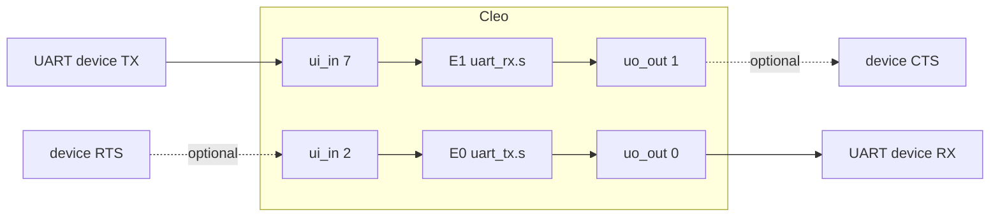
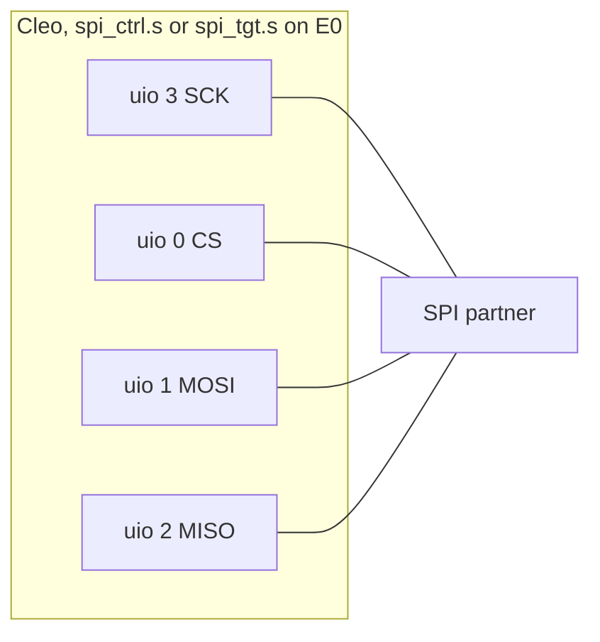
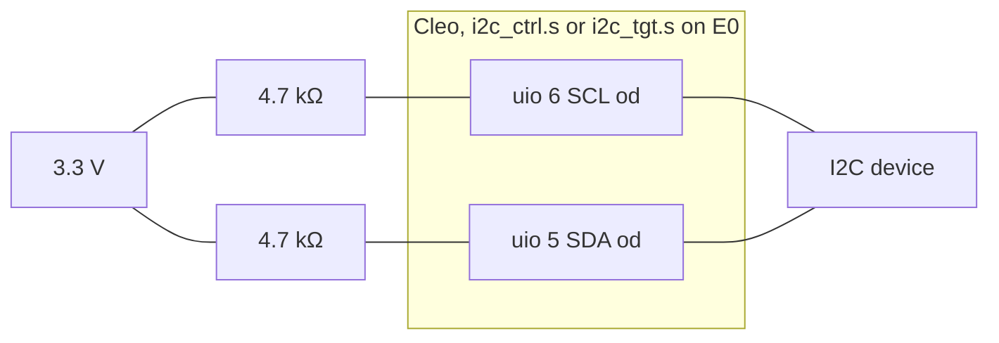
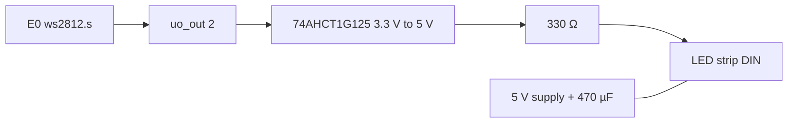
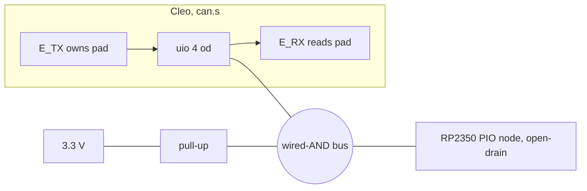
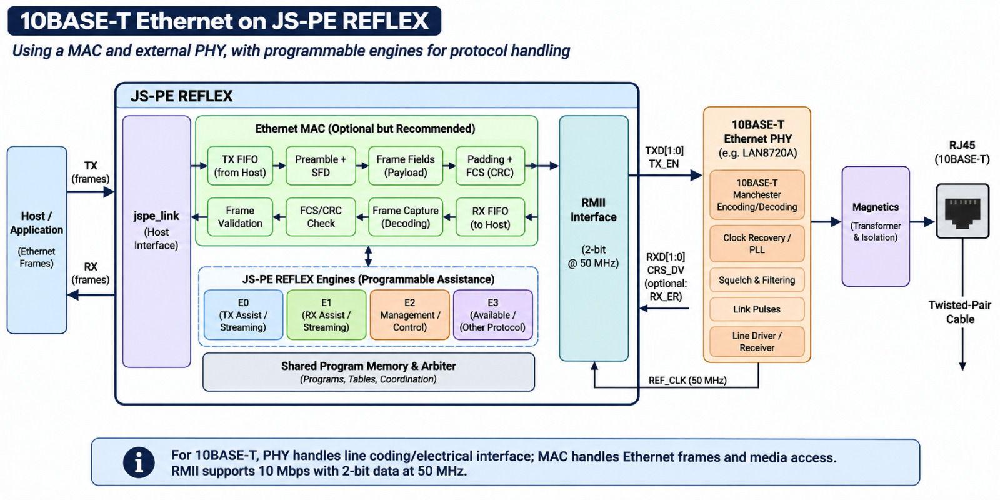

# Interfacing external devices

What can be wired to the chip and what it needs. Pin maps and parts come from [docs/spec/PINS.md](https://github.com/NotCleo/JS-PE/blob/main/docs/spec/PINS.md) (sections 3–5) and the program headers in [docs/spec/programs/](https://github.com/NotCleo/JS-PE/tree/main/docs/spec/programs). No external device has been connected yet: every "supported" row is verified in simulation only (ISS, RTL, gate level; see [VERIFICATION.md](https://github.com/NotCleo/JS-PE/blob/main/docs/VERIFICATION.md)). "Feasible" rows are my reading of the timing limits, with no program or test behind them.

## 1. Electrical rules

| Rule | Source |
|---|---|
| All I/O is 3.3 V; pads are not assumed 5 V tolerant; no on-chip pull-ups | PINS 1, 5 |
| `uo_out` pads are always driven (push-pull); they cannot be released or open-drain | PINS 1 |
| Open-drain and tri-state signals must be on `uio[7:0]`; an `od` pad drives low or releases, never high | PINS 1, ARCH 2.1 |
| After reset every `uio` is high-Z and every `uo_out` is 0 (H_TX 1). An idle-high output (UART TX, CS) is low until its pad is enabled; the loader sets the level first, then enables the pad | PINS 1, HOSTIF 6 |
| Fixed pads: `ui_in[3]`, `uo_out[4]`, `uo_out[5]` (host link). Every other pad is assigned at load time | PINS 2 |
| Pads free in every default map: `ui_in[0,1,5,6]`, `uo_out[6,7]`, `uio[4,7]` | PINS 4 |

## 2. Device table

| Device class | Protocol / modes | Pins (default map) | Extra parts | Status |
|---|---|---|---|---|
| UART device at 3.3 V (USB-UART bridge, GPS, BLE module) | UART 5–9 data bits, parity, 1/1.5/2 stop, inverted, MSB first, RTS/CTS | TXD `uo_out[0]`, RXD `ui_in[7]`, RTS `uo_out[1]`, CTS `ui_in[2]` | none | supported (simulation) |
| RS-232 device | UART | as above | RS-232 level transceiver | feasible (untested) |
| RS-485 / DMX512 bus | UART + driver-enable pin | as above + one spare pad for DE | RS-485 transceiver; program change for DE | feasible (no program) |
| SPI peripheral (flash, ADC, display) | SPI controller, modes 0–3, 1–16-bit words, MSB/LSB first | SCK `uio[3]`, CS `uio[0]`, MOSI `uio[1]`, MISO `uio[2]` | none | supported (simulation) |
| SPI controller (an MCU reading the chip) | SPI target, register-table device, modes 0–3 | same pads | none | supported (simulation) |
| I2C target device (EEPROM, sensor) | I2C controller, START / repeated START / STOP, ACK/NACK, clock stretching with timeout | SCL `uio[6]`, SDA `uio[5]`, both `od` | 2 x 4.7 kΩ to 3.3 V for 400 kHz (2.2 kΩ for long wires or 1 MHz); RP2350 internal pull-ups at 100 kHz, functional only | supported (simulation); single controller only (D041) |
| I2C controller (an MCU addressing the chip) | I2C target, 7-bit address, clock stretching | same pads | as above | supported (simulation) |
| WS2812 / SK6812 LED strip | single-wire NRZ, 3 timer ticks per bit | DOUT `uo_out[2]` | 5 V strip: 74AHCT1G125 level shifter, 330 Ω series resistor, 5 V supply with ≥ 470 µF | supported (simulation) |
| Manchester link (IEEE 802.3 convention or inverted) | TX and RX, clock recovery by windowed timer sync | TX `uo_out[3]`, RX `ui_in[4]` | none (jumper for loop-back) | supported (simulation) |
| CAN 2.0A bench bus (open-drain wired-AND, no transceiver) | 11-bit ID, data and remote frames, 125–500 kbit/s | bus `uio[4]` `od` | one pull-up: 1 kΩ in can_design.md, 2.2 kΩ in PINS 5 | supported (simulation); uses all 128 words |
| CAN bus with a transceiver | CAN 2.0A | TXD and RXD on two pads | 3.3 V CAN transceiver; program change (separate TX/RX pins instead of one `od` pad) | feasible (no program) |
| 1-Wire device | open-drain, µs-scale slots | one `uio` `od` pad | 4.7 kΩ pull-up | feasible (no program) |
| 5 V logic device | any | any | level shifter | needs external parts |
| Ethernet PHY (RMII) | 2 bits every clock at 50 MHz | — | — | not supported: beyond the 3–4 clk reaction floor |
| USB low speed | NRZI, bit stuffing, differential pair | — | — | not supported (future work) |

The RP2350 on the demo board can stand in for every supported partner (PIO UART/SPI, `SoftI2C`, GPIO capture), which is how the host examples are written (D008).

## 3. Diagrams per protocol family

### UART

### SPI

As controller the chip drives SCK, CS, MOSI; as target it drives MISO only while CS is low (released otherwise).

### I2C

### WS2812

### Manchester

### CAN (bench)

## 4. Not supported: Ethernet (concept only)

*Concept only — not implemented: RMII needs 2 bits every clock at 50 MHz, beyond the 3–4 clk reaction floor.*

The reaction floor is pad edge → pad change in 3–4 clk + pad (ARCH 4.1). A protocol that needs a new bit on every clock, or a reaction faster than that, is out of reach for this architecture at 50 MHz. 10BASE-T Manchester at 10 Mbit/s would need BIT = 5 clk; the Manchester program's limits are BIT ≥ 22 (TX) and BIT ≥ 18 (RX) ([manchester.s](https://github.com/NotCleo/JS-PE/blob/main/docs/spec/programs/manchester.s) header).
